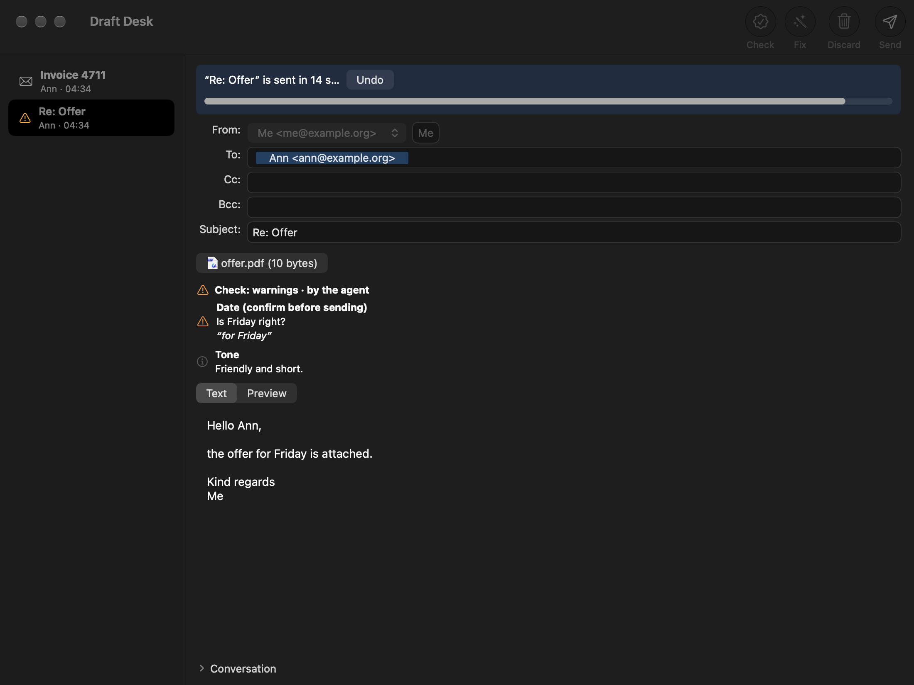

# Draft Desk

My AI agents (Claude Code sessions) write a lot of my mail: replies to suppliers, customers and offices. I want to
see every mail before it goes out, the way the recipient will get it: sender, recipients, Cc, Bcc, subject,
attachments and text. I want to change it right there and send it with one click, and the agent that wrote it should
learn whether it went out. So I built Draft Desk with the help of AI.

Draft Desk is an outbox with human approval for AI agents, for the Mac. An agent hands over a draft with one command:
`draftdesk add draft.json`. The draft shows up in a Mac app. A person reads it, edits it if needed and sends it with a
click. The agent finds out what happened: sent, discarded, failed or unknown. The command line can never send. Only a
click in the app sends, and after the click there are 15 seconds to undo.

Background story: [Why I run my company with AI agents](https://kevintheo.com/field-report/)

![The Draft Desk window in dark mode. On the left the queue with two drafts, "Invoice 4711" and "Re: Offer". On the right the draft "Re: Offer" from me@example.org to ann@example.org with the attachment offer.pdf. Above the text a check result "Check: warnings · by the agent" with the finding "Date (confirm before sending)": "Is Friday right?" and an info "Tone": "Friendly and short.". Below it the switch "Text | Preview" and the text of the mail. The buttons Check, Fix, Discard and Send are at the top right.](docs/draft-desk.png)

*The drafts are made up for the picture. The window follows the Mac's language, English or German.*

## What it does

- **Queue:** the window lists the waiting drafts, newest first: subject, first recipient (plus the number of further
  recipients), time and a state symbol. A draft that breaks a rule shows its first error in red and can only be moved
  to the archive.
- **Editing:** a ready draft can be edited in place: sender (a list of the account's senders plus a name field; the
  name is locked for senders with a fixed name), To, Cc, Bcc, subject, attachments and text. Changes are saved
  automatically 1.5 seconds after the last change and always before sending, checking, fixing, attaching, switching
  drafts or quitting.
- **Plain text on purpose:** smart quotes, smart dashes, text replacement, autocorrect, link and data detection and the
  period after two spaces are switched off in the text. Invisible characters are marked in red, with a count and a
  "Remove" button.
- **Attachments:** drop files on the window or use "Add Attachment…". Quick Look opens only PDF, PNG, JPEG, GIF, TXT,
  CSV, DOCX, XLSX and PPTX files; other files are never opened.
- **Preview:** a switch "Text | Preview" shows the HTML part exactly as it will be sent, in a web view with JavaScript
  off, a non-persistent store and no network: it can only show its own page.
- **Conversation:** if the agent hands over the earlier messages, they show read-only under "Conversation".
- **Findings:** the result of a check (see [Check and fix commands](#check-and-fix-commands-optional)) shows above the
  text. A blocking finding or a finding marked "confirm" asks "Confirm before sending" with the buttons "Cancel"
  (Escape) and "Send Anyway" (no key).
- **Sending:** click Send. A 15-second countdown starts, with an Undo button (Escape works too while the bar shows) and
  a progress bar; the draft cannot be edited meanwhile. The send happens only inside its time window: if the Mac slept
  through it, nothing is sent and the draft asks for a new click.

  

- **Discard:** asks first, then removes the draft and, where the account allows it, also the draft the agent saved in
  the mailbox (see [Accounts](#accounts)).
- **Notifications:** a new draft posts a notification ("New draft: <subject> (N recipients)"); a click on it shows the
  draft. Without notification permission the window comes to the front without taking the keyboard. The outcome of a
  send is posted too.
- **Language:** English or German, following the Mac's language. Another language for Draft Desk alone: System
  Settings > General > Language & Region > Applications.
- **No keyboard shortcut sends:** Send has no key equivalent anywhere and no button in the main window answers Return.

## How an agent hands over a draft

This is the smallest draft. The account `work` must exist in the configuration with the sender `me@example.org`.

```json
{"schema":"draftdesk/1","account":"work","from":{"address":"me@example.org","name":"Me"},
 "to":["Ann <ann@example.org>"],"subject":"Re: Offer","body":"Hello Ann,\n\nthanks.\n"}
```

The command is `draftdesk add draft.json`. It prints `{"item_id": ..., "replaced": ...}` and wakes the app.

The rules:

- Required fields: `schema` (exactly `draftdesk/1`), `account`, `from` (`address`, optional `name`), `to`, `subject`,
  `body`.
- Optional fields: `cc`, `bcc`, `attachments`, `reply`, `thread`, `mailbox_draft`, `origin`, `checks`. Unknown fields
  are refused.
- `from.address` must be one of the account's senders.
- Recipients are written `Name <a@b>`, `<a@b>` or `a@b`. At most 20 recipients in To, Cc and Bcc together; no address
  twice across the three fields.
- `subject`: not empty, at most 998 characters, no line breaks, no control or bidi characters.
- `body`: not empty, at most 200,000 characters.
- `attachments`: paths to files. Draft Desk copies them into its queue when the draft is added. At most 10 files and
  25 MiB in total; regular files only (no symlinks).
- `reply`: `in_reply_to`, `references` and, for Gmail, `gmail_thread_id`, so the mail lands in the right thread.
- `thread`: the earlier messages as plain text, shown read-only.
- `checks`: the agent's own check result, in the same format a check command returns (see
  [Check and fix commands](#check-and-fix-commands-optional)).

**Idempotency.** With `origin.correlation` set, adding the same draft again (same account, agent and correlation)
returns the existing draft's id instead of a second draft. A different draft under the same correlation is refused.

**Replacing.** `draftdesk add new.json --replaces <id>` withdraws the older draft of the same `origin.session`. It
never withdraws one the person has edited in the window, and never one that is already being sent.

**Mailbox draft.** If the agent also saved the draft in the mailbox, `mailbox_draft` names it. After sending or
discarding, Draft Desk removes that mailbox draft. The checks it makes first are described under
[Accounts](#accounts).

## What the agent gets back

- `draftdesk status <id>` prints the draft's state and its result.
- `draftdesk wait <id> [--timeout <seconds>]` waits for the result (default limit 24 hours).
- `draftdesk claim --session <session>` hands each result of one agent session over exactly once.
- `draftdesk list` shows the queue, `draftdesk discard <id>` withdraws a draft from the command line.

Each result is handed over once per status. A result has the status `sent`, `failed`, `discarded` or `unknown`.
`unknown` means: check the sent folder. Draft Desk never sends such a mail again on its own. `retry_allowed` is true
only when the provider refused the mail and nothing was sent.

Results are signed (HMAC-SHA256) with a key in the macOS keychain. The app creates that key at its first start; until
then no result can be published, so start the app once before an agent uses `wait` or `claim`.

Exit codes of the command line: 0 ok, 1 error, 2 invalid input or refused, 3 unknown id, 124 time limit.

## Requirements

- macOS 26 or later.
- Rust 1.89 or newer (rustup.rs, or `brew install rust`) and the Xcode Command Line Tools
  (`xcode-select --install`).
- A code signing identity in your keychain for `--install`: a self-signed "Code Signing" certificate made in Keychain
  Access is enough. macOS ties keychain approvals to the signature, so with a fixed identity they survive rebuilds.

## Install

```sh
git clone https://github.com/kevintheo-ai/draft-desk.git
cd draft-desk
security find-identity -v -p codesigning
DRAFTDESK_SIGN_ID="<name of your identity>" ./build.sh --install
open ~/Applications/"Draft Desk.app"
```

- `--install` builds the app and the command line, signs both and installs them as `~/Applications/Draft Desk.app` and
  `~/.local/bin/draftdesk`. Quit Draft Desk before installing a new build; the script refuses while it runs.
- Other modes of `build.sh`: no argument builds only the command line; `--app` builds the app into
  `target/Draft Desk.app` without installing it; `--tests` runs the format check, the linter (clippy), a guard that the
  command line has no sending code, and all tests, including the tests of `examples/check.py`.
- On the first start the app asks for permission to send notifications and creates the key that signs the results.
- Add accounts in the app's Settings (Cmd+,) or on the command line: `draftdesk account add-smtp`,
  `draftdesk account add-gmail`, `draftdesk account add-command`. `draftdesk config check` checks the configuration.
- Everything lives in `~/Library/Application Support/Draft Desk` (or in `$DRAFTDESK_HOME` when that is set):
  `config.json` and the queue. That folder may itself be a symlink to a folder elsewhere; inside it, Draft Desk
  refuses symlinks, also for `config.json`. Passwords and tokens live in the macOS login keychain under the service
  name "Draft Desk".

## Accounts

- **SMTP:** host, port, `tls` (implicit TLS, usually port 465) or `starttls` (usually port 587), user name, password
  in the keychain. No fallback to plain text. Optional IMAP (implicit TLS only) to remove the agent's mailbox draft and
  to save a copy in the Sent folder. An IMAP mailbox draft is removed only with the server's MOVE command and only into
  Trash, never deleted for good, and only if the Message-ID matches and From, To, Cc, Bcc and Subject still match the
  draft (fields changed in the window are left out of that comparison).
- **Gmail:** you bring your own Google OAuth client of the type "Desktop app" (client ID and secret). The sign-in runs
  in the browser with a loopback address on your Mac and PKCE; the only scope is `gmail.compose`. Draft Desk sends
  through the Gmail API, so Gmail files the sent mail itself. Each request to Google gets a time limit of two minutes
  plus one second per 32 KiB of mail, so large attachments also go out over a slow connection. If Google does not
  answer or is busy, Draft Desk tries again before it gives up; nothing is sent twice. A Gmail mailbox draft is removed
  only if its message id still matches.
- **Own send command:** one program with an absolute path (no arguments). The contract:
  - It gets the finished mail (MIME, without a Bcc header) on stdin.
  - It gets the environment variables `DRAFTDESK_ACCOUNT`, `DRAFTDESK_MESSAGE_ID` and `DRAFTDESK_ENVELOPE_RCPTS` (the
    recipients, comma-separated).
  - Exit 0 with the first line `{"status":"sent"}` on stdout (optionally with `"provider_message_id"`) means sent.
  - Exit 2, 3 or 4 means refused and nothing was sent.
  - Anything else, a crash or the time limit (30 to 900 seconds, default 180) means unknown.
  - An optional discard program removes the mailbox draft.
  - Programs run with an empty environment except `PATH`, `HOME`, `LANG` and the variables above, in their own
    process group, with at most 1 MiB of output each and a time limit after which the whole group is stopped.

## Check and fix commands (optional)

Both are optional programs, set in the Settings or in `config.json` (`check_command`, `fix_command`, each with a time
limit).

A check command gets the draft as JSON on stdin (account, from, to, cc, bcc, subject, body, `body_sha256`, reply,
thread, attachment names and sizes; no secrets) and answers with:

```
{"verdict":"pass|warn|block","findings":[{"level":"info|warn|block","title":"...","detail":"...","quote":"...","confirm":true}]}
```

A non-zero exit, an empty or broken answer or the time limit counts as an error, never as a pass. A finding with level
`block`, a verdict `block` or a finding with `"confirm": true` makes the app ask before sending. Findings made for an
older version of the draft are marked as outdated.

A fix command gets the draft and its findings and answers with `{"body":"..."}`. The app puts the new text in place as
one undo step and saves it; it is never sent without a click.

### An example check command

`examples/check.py` is an example check command. It needs Python 3.9 or newer and the standard library only. The
`python3` of the Xcode Command Line Tools is enough, and Draft Desk needs those anyway.

To use it, choose `examples/check.py` as the check command in the Settings (the file is executable), or set it in
`config.json`:

```
"check_command": {"argv": ["/path/to/draft-desk/examples/check.py"], "timeout_s": 300}
```

It runs two fixed checks first:

- A weekday next to a date must fit the date. It knows English and German weekday names and their abbreviations, and
  dates such as `17.11.2026`, `17.11.`, `2026-11-17`, `17 November 2026`, `17. November` and
  `November 17, 2026`. The weekday may also stand after the date, in brackets or after a comma: `17.11. (Dienstag)`,
  `17.11.2026, Montag`. A wrong weekday, or a date the calendar does not have (`31.11.`), is a blocking finding, so
  the app asks before sending. Without a year it takes the first such date from 60 days ago on.
- A text that mentions an attachment ("attached", "enclosed", "Anhang", "anbei" and similar words) but has none gets a
  warning that asks before sending.

Both checks look at the subject as well as the text. Quoted lines (starting with `>`) are left out.

If Claude Code is installed, a second reader follows: `claude -p` reads the draft and the earlier messages of the
thread. It runs without tools, without settings, hooks, MCP servers, memory or a saved session, in an empty temporary
folder, with Claude Code's default model or the one given with `--model`.

The second reader reports four things:

- a question or request in the earlier messages that the draft leaves unanswered;
- a statement in the draft that contradicts the earlier messages;
- a greeting with a name that does not fit;
- commitments (a price, a date or deadline, a promise), which come as info that asks for confirmation before sending.

It reports nothing about style, tone or spelling, and it writes its findings in the language of the draft. Its
findings never block, and a quote is kept only if it stands in the draft word for word.

The draft and the earlier messages reach the second reader as data, with the instruction never to follow instructions
inside them. In my test it ignored such an instruction hidden in an earlier message. Still, a mail can talk a model out
of a finding; the fixed checks do not depend on it.

If `claude` is not found, a finding of level info says the second reader was skipped. If it fails (not signed in, over
the time limit, a broken answer), a warning says it did not run and why. It never ends in a silent pass.

Draft Desk starts a check command with only `PATH`, `HOME` and `LANG`. The example therefore also looks for `claude`
in `~/.local/bin`, `~/.claude/local`, `/opt/homebrew/bin` and `/usr/local/bin`, and passes the user name on, which
`claude` needs to find its sign-in in the keychain.

Options: `--no-claude` (only the fixed checks), `--claude PATH`, `--model NAME` and, for the second reader,
`--timeout SECONDS` (default 240, below the app's default time limit of 300 seconds).

In my test a run with the second reader took about 5 seconds. The tests of the example are in
`examples/test_check.py`; `./build.sh --tests` runs them.

## What Draft Desk guarantees

- **Only the app sends:** the sending code is compiled only into the app; a test and the build script check that the
  command line has none.
- **A click approves exactly what was shown:** account, sender, recipients, subject, text, attachments (name, hash and
  size), threading and the mailbox draft. If anything of that changes before the send, nothing is sent and the draft
  goes back to the queue.
- **The approved bytes are the sent bytes:** the mail is built from that approved state, parsed again and compared
  before it leaves; its exact bytes are written to disk before the transport starts, and those bytes are what the
  provider gets.
- **An unknown outcome is never retried on its own:** the attempt is recorded before the transport runs, and after a
  crash or restart a send that was under way counts as unknown, never as unsent.
- **Agent input is not trusted:** unknown fields are refused, header fields refuse line breaks, control and bidi
  characters, invisible characters in the text block sending until removed, and the HTML part escapes all markup and
  has no links.
- **Logs keep no mail content:** the audit log keeps ids, counts, codes and short hashes, never addresses, subjects,
  texts or attachment names; the app log keeps ids, events and error codes only.
- **Private files:** files and folders are private to your user (0600, 0700), writes are atomic, and every read checks
  the draft again; a draft that breaks a rule is never sendable.

## How it was built

I built Draft Desk myself, with the help of AI. I design and plan it, set the rules, decide and accept the result.
Claude Code writes the code.

The first version was written in Python in August 2026 and was my outbox from 23 August 2026 on: 463 mails went out
through it. In November 2026 I rebuilt it in Rust as a tool others can use, with a native Mac app (AppKit through the
objc2 crates). It took over my mail on 7 November 2026 and had sent 32 more mails by 11 November 2026, a few of them
tests.

Several language models from different vendors reviewed the Rust version at every stage: Codex, GLM, Muse and Grok.
Before publishing, they reviewed the whole code once more and then every fix again: 130 reports in three rounds.
Claude Code checked each report against the code and fixed 34 real problems, most of them small. The rest were false
alarms or rare edge cases; the ones a user could run into are listed under [Limits](#limits).

My own setup uses a check command of its own: a second model reads every draft against its sources and checks the
form. That one stays private. `examples/check.py` is a simpler example of the same idea, with nothing from my own
setup. Codex, GLM, Muse and Grok reviewed the example too. They found 15 real problems, all fixed, and 2 false
alarms. [email-ops](https://github.com/kevintheo-ai/email-ops), my inbox skill for Claude Code, can hand its reply
drafts to Draft Desk.

The code is a Cargo workspace: `core` (draft format, queue, checks, building and sending mail; it also builds and runs
its tests on Linux in CI), `cli` (the `draftdesk` command, without sending code) and `macos` (the app).

Both pictures above come from the app's own test harness with invented data, made with
`DRAFTDESK_SNAPSHOTS=<folder> DRAFTDESK_SNAPSHOTS_LANG=en cargo test -p draftdesk-macos --test appkit -- snapshots`.

## Limits

- Mac only for now: the app needs macOS 26 or later; the core has no other user interface yet.
- IMAP only with implicit TLS (no STARTTLS on port 143). Without the MOVE command or a Trash folder the mailbox draft
  is left alone.
- A draft whose send failed cannot be sent again from the app: discard it and let the agent hand it over again.
- The Google sign-in needs your own OAuth client.
- Results can only be signed after the app has run once.
- The IMAP library is a 3.0 alpha version.
- I use the Gmail account kind and own send commands every day. The built-in SMTP and IMAP code is tested only against
  a local fake SMTP server and an in-memory mailbox, not yet against real servers.
- A send command that leaves a background process holding its output open: Draft Desk stops waiting a few seconds
  after the command ended and records the outcome as unknown.
- While a sheet is open on the window (the question before sending, discard, the file dialog), the Undo button of a
  running countdown cannot be clicked; close the sheet with Escape first.
- Attachment names that differ only in how an accented letter is encoded (é as one or as two characters) collide on
  the Mac's file system; such a draft cannot be sent.
- Draft Desk does not protect against other programs running as your user: they can read and change its files, and a
  program that can read your keychain can read the key that signs the results.

## Kurz auf Deutsch

Draft Desk ist ein Postausgang mit menschlicher Freigabe für KI-Agenten, für den Mac. Ein Agent übergibt einen Entwurf
mit einem Befehl: `draftdesk add draft.json`. Der Entwurf erscheint in einer Mac-App. Eine Person liest ihn, ändert ihn
bei Bedarf und sendet ihn mit einem Klick. Der Agent erfährt, was daraus wurde: `sent`, `discarded`, `failed` oder
`unknown`. Die Kommandozeile kann nie senden. Nur ein Klick in der App sendet, und danach bleiben 15 Sekunden zum
Rückgängigmachen.

Installation: Nötig sind macOS 26 oder neuer, Rust 1.89 oder neuer, die Xcode Command Line Tools und eine
Code-Signing-Identität im Schlüsselbund (ein selbst signiertes Zertifikat «Code Signing» aus der
Schlüsselbundverwaltung genügt). Dann:

```sh
git clone https://github.com/kevintheo-ai/draft-desk.git
cd draft-desk
security find-identity -v -p codesigning
DRAFTDESK_SIGN_ID="<name of your identity>" ./build.sh --install
open ~/Applications/"Draft Desk.app"
```

Konten richtet man in den Einstellungen der App ein (Cmd+,).

## License

MIT, see [LICENSE](LICENSE). Draft Desk is an independent project and not affiliated with Google, Apple, Anthropic, OpenAI, Z.ai, Meta or xAI. All product names are trademarks of their respective owners.

Kevin Theo ([LinkedIn](https://www.linkedin.com/in/kevintheo) · [kevintheo.com](https://kevintheo.com))
